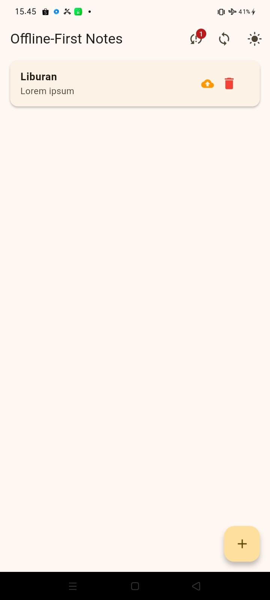
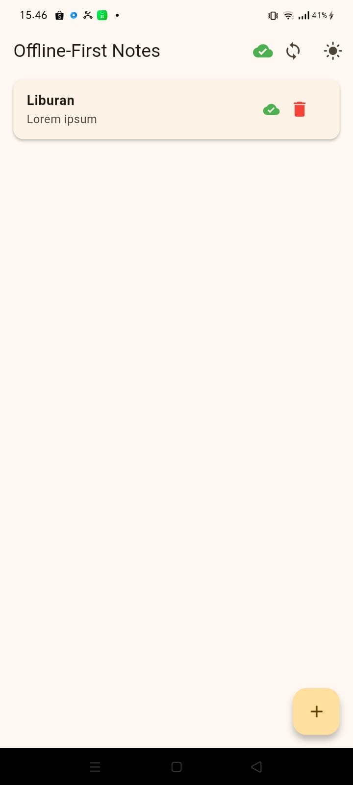
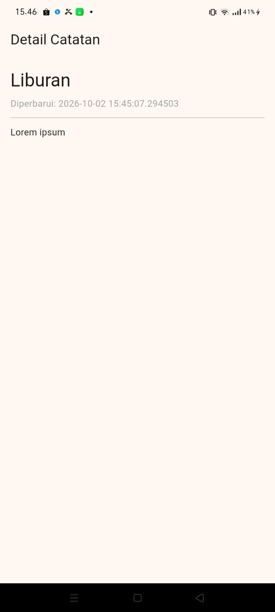
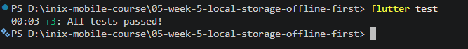

# Laporan Praktikum Pemrograman Mobile
## #05 | Local Storage & Offline-First Notes Application

* **Nama Mahasiswa:** Adi Luhung
* **NIM:** 244107020088
* **Kelas:** TI-3D

---

## Fitur Utama Aplikasi
Aplikasi ini menerapkan arsitektur *Offline-First* sejati dengan memanfaatkan kombinasi penyimpanan lokal hibrida untuk memastikan aplikasi tetap berfungsi penuh tanpa koneksi internet:
* **Penyimpanan Hibrida:** Menggunakan `SharedPreferences` untuk data konfigurasi kecil (Tema Terang/Gelap & Waktu Terakhir Dibuka) dan `sqflite` (SQLite) untuk data catatan terstruktur.
* **Cache-First Read:** Data dibaca secara instan dari database lokal gawai saat aplikasi dibuka untuk performa maksimal.
* **Dirty Flag System:** Setiap pembuatan catatan baru di mode offline otomatis ditandai kotor (`dirty = 1`) sebagai penanda antrean sinkronisasi.
* **Antrean Outbox Sinkronisasi:** Menyediakan tombol sinkronisasi manual untuk memproses data kotor lokal ke server simulasi ketika koneksi kembali online.
* **Navigasi Rute Dinamis:** Menggunakan `go_router` untuk membuka halaman detail catatan berbasis pengiriman parameter ID.

---

## Dokumentasi Screenshot & Penjelasan Fitur

Silakan ambil screenshot dari HP Anda dan simpan ke folder `screenshots/` dengan nama yang sesuai di bawah ini:

### 1. Bukti Fitur Jalun Offline (Mode Pesawat)

* **Penjelasan Gambaran Anda:** Diambil saat HP dalam kondisi **Mode Pesawat (Offline)**. Aplikasi terbukti tetap berfungsi 100% lancar untuk membaca dan menambah catatan baru. Tampak badge lencana angka di kanan atas menunjukkan jumlah antrean sinkronisasi, serta munculnya **ikon awan oranye** pada item catatan baru sebagai penanda status kotor (*dirty flag*).

---

### 2. Tampilan Sukses Sinkronisasi (Kembali Online)

* **Penjelasan Gambaran Anda:** Diambil setelah koneksi internet HP dinyalakan kembali dan tombol **Sync (ikon melingkar di appBar)** ditekan. Fungsi `syncNotes` berhasil mengirimkan payload data kotor lokal ke server simulasi, mengubah nilai status *dirty* kembali ke 0, menghilangkan badge antrean, dan mengubah **ikon awan menjadi hijau** tanda data aman.

---

### 3. Tampilan Halaman Detail Catatan (Navigasi Parameter)

* **Penjelasan Gambaran Anda:** Diambil saat salah satu item catatan diklik. Halaman otomatis berpindah ke layar detail mandiri memanfaatkan parameter rute ID dinamis dari `go_router` untuk memuat isi konten secara utuh dan terisolasi.

---

### 4. Hasil Pengujian Statis & Unit Pengujian Lulus (Passed)

* **Penjelasan Gambaran Anda:** Bukti fisik dari terminal laptop setelah menjalankan perintah `flutter analyze` dan `flutter test`. Seluruh analisis kode berstatus bersih (*No issues found*) dan semua unit test fungsional menggunakan objek repositori palsu (*Fake Note Repository*) lolos pengujian secara otomatis dengan status **All tests passed**.

---

## Hasil Refactoring Challenge
* **Pemisahan Komponen UI (`note_tile.dart`):** Ekstraksi baris komponen dari `ListView.builder` dipisahkan menjadi widget independen demi memangkas siklus konsumsi memori render layar gawai saat digulir cepat.
* **Sentralisasi Sinkronisasi (`sync.dart`):** Memindahkan seluruh logika fungsi `syncNotes` keluar dari layer antarmuka agar proses sinkronisasi fokus di layer data, menjaga kebersihan arsitektur kode di layer UI.
* **Halaman Detail Terpisah (`note_detail_page.dart`):** Membuat rute baru (`/note/:id`) untuk menampilkan detail catatan secara eksklusif berdasarkan pencarian ID di repositori lokal.

---

## AI Prompt Challenge & Perbandingan Storage

**Teks Prompt Eksperimen yang Digunakan:**
> *"Aplikasi Flutter Offline Notes: CRUD catatan + preferensi tema. Bandingkan SharedPreferences, Hive, sqflite (SQLite), dan Drift untuk dua kebutuhan ini. Beri rekomendasi final dalam bentuk 1 tabel beserta skema tabelnya."*

### Tabel Analisis Perbandingan Teknologi Penyimpanan Lokal:

| Kriteria / Fitur | SharedPreferences | Hive (NoSQL) | sqflite (SQLite) | Drift (Reactive SQL) |
| :--- | :--- | :--- | :--- | :--- |
| **Kompleksitas Query** | Sangat Rendah | Rendah (Key-Value) | Tinggi (SQL Manual) | Menengah (Type-safe) |
| **Dukungan Relasi** | Tidak Mendukung | Terbatas | Mendukung Penuh | Mendukung Penuh |
| **Kecepatan Baca/Tulis** | Sangat Cepat | Sangat Cepat | Cepat | Cepat |
| **Ukuran Boilerplate** | Sangat Kecil | Kecil | Besar | Sangat Besar |
| **Cocok Untuk** | Data Primitif Kecil | Dokumen Ringan | Data Relasional | Aplikasi Skala Besar |

**Keputusan Akhir Praktikum:** Kombinasi **SharedPreferences** (untuk tema) dan **sqflite** (untuk catatan) dipilih karena merupakan pondasi standar industri yang paling stabil, berkinerja tinggi untuk kueri data terstruktur, serta sangat fleksibel untuk implementasi manipulasi status *dirty flag* secara manual.

---

## Jawaban Refleksi Laporan Modul

* **Mengapa daftar catatan tidak boleh disimpan semuanya di SharedPreferences? Apa yang rusak jika aturan ini dilanggar?**
  `SharedPreferences` didesain hanya untuk menyimpan data primitif kecil berstruktur key-value sederhana. Jika daftar catatan disimpan di sana dalam bentuk string JSON panjang, aplikasi harus membaca dan menulis ulang seluruh string tersebut ke memori gawai setiap kali ada satu karakter catatan yang diubah. Hal ini akan menghancurkan performa kecepatan aplikasi, memicu kebocoran RAM, menghilangkan kemampuan kueri pencarian kata kunci, serta membuat antrean sinkronisasi menjadi sangat rapuh.

* **Kapan strategi cache-first cukup, dan kapan Anda membutuhkan strategi lain (misalnya network-first) untuk data bacaan?**
  Strategi *cache-first* (baca data lokal dulu) sangat pas untuk aplikasi produktivitas personal seperti catatan atau draf tulisan, di mana kecepatan buka aplikasi menjadi prioritas utama pengguna. Namun, untuk aplikasi dengan fluktuasi perubahan data waktu nyata yang krusial seperti harga saham, info tiket penerbangan, atau saldo bank, strategi *network-first* wajib digunakan agar data yang dilihat pengguna tidak kedaluwarsa (*stale data*).

* **Bagaimana dirty flag berubah menjadi antrean sync tanpa memblokir antarmuka UI? Kapan antrean terpisah (tabel outbox) menjadi perlu?**
  Proses perubahan dilakukan dengan memisahkan fungsi kompilasi antrean ke dalam thread asinkron (`Future/AsyncNotifier`) di luar siklus antarmuka utama. UI aplikasi tetap merespons input ketukan pengguna dengan lancar karena proses pemeriksaan data bertanda `dirty = 1` berjalan di latar belakang (*background thread*). Tabel antrean terpisah (*outbox*) menjadi sangat perlu jika aplikasi sudah mendukung fitur kompleks seperti antrean unggah file media (gambar/video) atau operasi penghapusan data relasional bertingkat yang rawan gagal kirim akibat putus sinyal jangka panjang.
