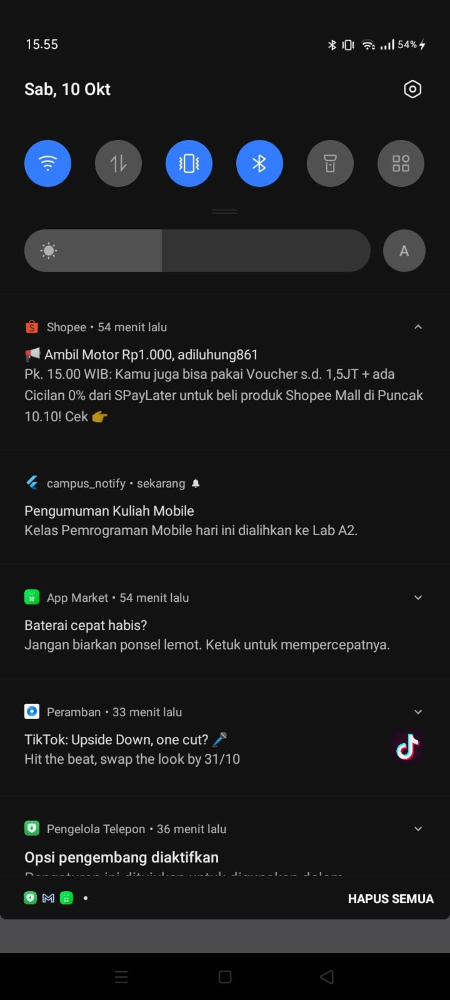
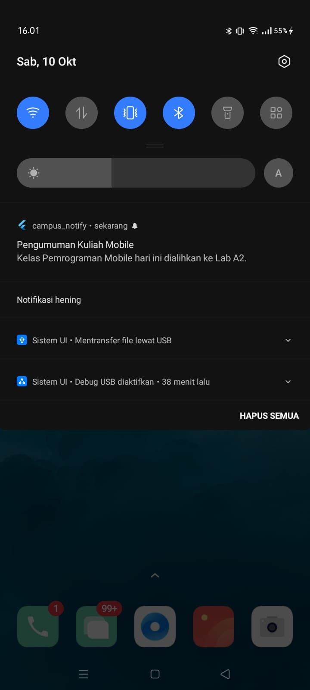
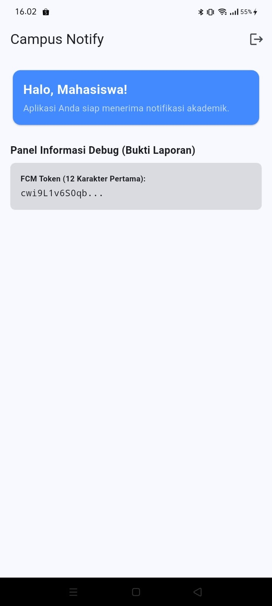
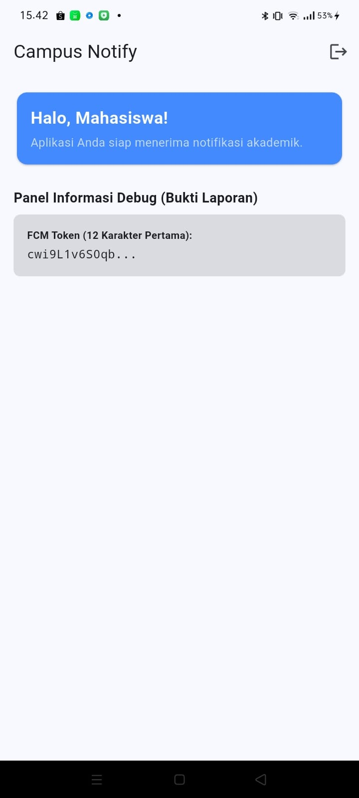
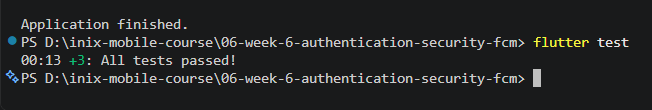

# Laporan Praktikum Pemrograman Mobile
## #06 | Authentication Security & Firebase Cloud Messaging (FCM)

* **Nama Mahasiswa:** Adi Luhung
* **NIM:** 244107020088
* **Kelas:** TI-3D

---

## Fitur Utama Aplikasi
Aplikasi **Campus Notify App** menerapkan arsitektur autentikasi mobile yang aman berstandar industri dikombinasikan dengan sistem pengiriman pesan berbasis awan (Cloud Messaging):
* **Secure Storage Session:** Penyimpanan `access_token` dan `refresh_token` disimpan secara eksklusif menggunakan entri terenkripsi `flutter_secure_storage` (Keystore/Keychain), menghindari kerentanan kebocoran data.
* **Auto-Refresh Sesi Interceptor:** Memanfaatkan pustaka `Dio` untuk menangkap galat `401 Unauthorized` secara asinkron di layer jaringan, menyegarkan token via repositori, dan mengulangi request yang gagal tanpa interupsi pada layer antarmuka.
* **Manajemen Siklus Hidup Token FCM:** Mengimplementasikan fungsi pelacakan token gawai secara aktif via `onTokenRefresh` untuk menjamin data token registrasi di database server tidak basi.
* **Deep Link Navigation Per rute:** Memanfaatkan kombinasi `GoRouter` dan `flutter_local_notifications` untuk memproses gabungan payload `notification` + `data` secara instan menuju rute dinamis `/pengumuman/:id` pada tiga kondisi *app state*.

---

## Dokumentasi Screenshot & Penjelasan Fitur

### 1. Bukti Tampilan Banner Notifikasi Terbuka (State Foreground)

* **Penjelasan Gambaran Anda:** Diambil saat aplikasi sedang terbuka aktif di layar depan gawai. Ketika Firebase menerima payload dari konsol, sistem tidak memicu banner otomatis gawai. Fungsi `listenForeground` berhasil menangkap objek `RemoteMessage` dan memicu pembuatan banner lokal secara manual memanfaatkan pustaka `flutter_local_notifications`.

---

### 2. Tampilan Banner Sistem Otomatis (State Background)

* **Penjelasan Gambaran Anda:** Diambil ketika aplikasi berada dalam kondisi di-*minimize* (kondisi latar belakang). Pengiriman pesan dengan tipe payload gabungan berhasil memicu subsistem OS gawai untuk menampilkan banner notifikasi standar bawaan pabrik secara otomatis.

---

### 3. Tampilan Sukses Deep Linking Rute Dinamis (Klik Notifikasi)

* **Penjelasan Gambaran Anda:** Diambil sesaat setelah banner notifikasi diketuk oleh pengguna. Fungsi `setupNotificationClicks` berhasil menangkap parameter rute di dalam payload `data['route']` dan memerintahkan `GoRouter` melakukan interupsi navigasi langsung melompat ke halaman detail pengumuman `/pengumuman/id` secara utuh.

---

### 4. Pembuktian Validasi Sisi Keamanan Token (Halaman Dashboard)

* **Penjelasan Gambaran Anda:** Tampilan panel Debug informasi pada beranda aplikasi yang memuat token registrasi FCM gawai. Sesuai dengan batasan regulasi keamanan modul praktikum, token gawai ditampilkan secara terpotong (hanya 12 karakter pertama saja) demi mencegah eksploitasi data privasi token penuh pada laporan berkas.

---

### 5. Hasil Pengujian Statis & Unit Pengujian Lulus (Passed)

* **Penjelasan Gambaran Anda:** Bukti fisik dari terminal laptop setelah menjalankan perintah verifikasi proyek secara menyeluruh. Hasil eksekusi `flutter analyze` berstatus bersih total (*No issues found*) dan unit pengujian asinkron simulasi sesi serta perutean data notifikasi lolos pengujian secara otomatis dengan status **All tests passed**.

---

## Hasil Refactoring Challenge
* **Sentralisasi Penjaga Rute Guard:** Konfigurasi filter `redirect` diletakkan terpusat pada file `lib/main.dart` memanfaatkan objek notifier `authStateProvider` untuk mendepak pengguna tak dikenal secara paksa kembali ke `/login`.
* **Modularisasi Manajemen State:** Seluruh pendaftaran komponen provider global (`tokenStoreProvider`, `apiClientProvider`, `authStateProvider`) dipisahkan keluar dari fungsi utama masuk ke dalam berkas terisolasi `lib/providers/auth_provider.dart` demi menjaga kebersihan kode.
* **Pembersihan Lint Parameter:** Mengeliminasi seluruh peringatan *warning lint* oranye pada argumen perutean dengan menyesuaikan parameter berpasangan `(context, state)` yang valid pada penulisan struktur `GoRoute`.

---

## AI Prompt Challenge & Perbandingan Pola Login

**Teks Prompt Eksperimen yang Digunakan:**
> *"Aplikasi Flutter Campus Notification App. Stack: firebase_messaging, flutter_local_notifications, flutter_secure_storage, go_router, Riverpod. Buatkan PushService dengan requestPermission + getToken + onTokenRefresh..."*

### Tabel Analisis Perbandingan Pola Autentikasi Industri:

| Fitur Utama | Firebase Auth (Email/Google) | JWT Refresh Token (Custom API) | OAuth (Google SSO) |
| :--- | :--- | :--- | :--- |
| **Kebutuhan Server** | Tanpa membangun server auth sendiri | Membutuhkan Backend Sendiri | Mengandalkan OAuth Provider |
| **Keamanan Token** | Dikelola penuh oleh SDK Firebase | Menggunakan pasangan Access + Refresh Token | Menggunakan authorization code exchange |
| **Karakteristik** | Sangat Instan & Praktis | Sangat Fleksibel & Terkontrol | Standar Login Sosial Terpusat |
| **Kasus Penggunaan** | Aplikasi kampus/umkm skala cepat | Backend kampus milik internal sendiri | Single Sign-On (SSO) Akun Kampus |

---

## Jawaban Refleksi Laporan Modul

* **Mengapa refresh token tidak boleh disimpan di SharedPreferences? Apa risikonya bila bocor?**
  `SharedPreferences` menaruh berkas datanya dalam format XML biasa tanpa proteksi enkripsi internal di media penyimpanan lokal gawai. Jika gawai terinfeksi malware, token berumur panjang ini dapat dibaca dengan mudah. Kebocoran `refresh_token` sangat fatal karena peretas bisa menggunakannya untuk terus menerbitkan `access_token` baru tanpa batasan waktu untuk membajak identitas korbannya. Oleh karena itu, token harus diamankan di `flutter_secure_storage`.

* **Apa yang rusak bila onTokenRefresh diabaikan selama satu semester perkuliahan?**
  Token FCM dari Firebase sewaktu-waktu dapat berganti secara otomatis akibat gawai melakukan instalasi ulang, kloning sistem, atau *clear data*. Jika fungsi `onTokenRefresh` diabaikan, server backend kampus akan terus memegang token lama yang sudah hangus/basi. Dampaknya, mahasiswa tersebut tidak akan pernah bisa menerima dorongan pengumuman kelas perkuliahan lagi di gawainya selama satu semester penuh.

* **Kapan memakai topik dan kapan memakai token perangkat? Beri contoh pesan kampus untuk masing-masing.**
  Strategi topik digunakan untuk pola penyebaran informasi masal searah (*broadcast*) tanpa membutuhkan validasi identitas personal. Sebaliknya, token perangkat wajib digunakan untuk lalu lintas informasi privat rahasia yang terikat khusus ke satu entitas user.
  * **Contoh Topik (`pengumuman-kampus`):** *"Informasi: Seluruh aktivitas perkuliahan dialihkan ke daring esok hari karena agenda wisuda."*
  * **Contoh Token Perangkat:** *"Notifikasi Keuangan: Tagihan UKT Semester Ganjil milik NIM 244107020088 terverifikasi Lunas."*
