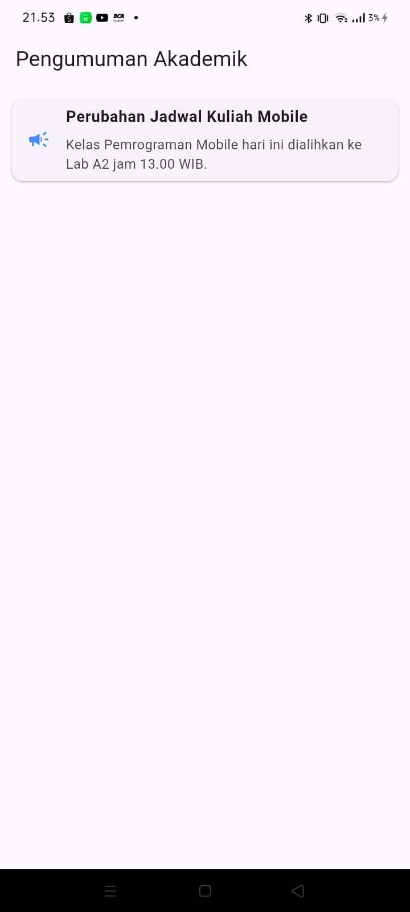
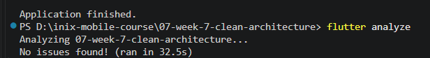
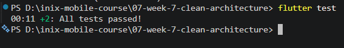

# Laporan Praktikum Pemrograman Mobile
## #07 | Refactoring Proyek - Feature-First Clean Architecture

* **Nama Mahasiswa:** Adi Luhung
* **NIM:** 244107020088
* **Kelas:** TI-3D

---

## 1. Justifikasi Arsitektur & Analisis Trade-Off (AI Challenge)

Pada praktikum minggu ke-7 ini, struktur kode proyek minggu sebelumnya yang berbentuk `layer-first` direfaktor secara menyeluruh menjadi pola arsitektur **`feature-first Clean Architecture`** dengan pembagian modular per komponen fitur (`announcements` dan `auth`).

### Matriks Pertimbangan Keputusan Desain (Trade-Off):
* **Penerapan Use Case Tunggal:** Desain use case `GetAnnouncements` dibuat secara khusus untuk memisahkan satu alur bisnis utama. Desain ini menghindari penumpukan logika bisnis di dalam satu berkas tunggal yang dapat melanggar *Single Responsibility Principle*.
* **Pemisahan Entity vs Model:** Objek bisnis murni diisolasi ke dalam berkas `announcement.dart` tanpa melibatkan kode konversi platform apa pun. Proses pemetaan manipulasi data masukan dari dunia luar dikunci rapat hanya di dalam `announcement_model.dart` pada layer data.
* **Biaya Over-Engineering:** Untuk operasi CRUD satu baris yang sangat sederhana, penulisan pola berlapis ini memang tergolong *over-engineering* karena menambah jumlah berkas baru yang signifikan. Namun, langkah taktis ini bernilai sepadan demi menjaga kebersihan dependensi jangka panjang, kemudahan isolasi testing, serta kebebasan UI dari keterikatan terhadap database lokal maupun jaringan API luar.

---

## 2. Dokumentasi Screenshot Bukti Praktikum

### A. Tampilan Antarmuka Halaman Pengumuman Berbasis Clean Architecture

* **Penjelasan:** Menampilkan halaman beranda aplikasi yang berhasil memuat data kartu pengumuman secara dinamis. Layer presentation (UI) benar-benar steril dan hanya membaca state dari provider tanpa terkontaminasi detail SQL, Dio, maupun parsing data mentah.

### B. Hasil Validasi Analisis Statis (Flutter Analyze)

* **Penjelasan:** Bukti eksekusi perintah analisis kode di terminal gawai. Proyek berstatus bersih total tanpa adanya *warning lint*, *typo*, maupun kesalahan aturan arsitektur.

### C. Hasil Eksekusi Unit Test Lulus (All Tests Passed)

* **Penjelasan:** Pengujian use case memanfaatkan *Fake Object Repository* berhasil lolos 100% tanpa membutuhkan koneksi database atau Firebase sungguhan, membuktikan isolasi logika bisnis di layer domain berjalan sempurna.

---

## 3. Hasil Validasi Sterilitas Layer (Grep Rule Verification)

Sesuai dengan *AI Verification Checklist* di halaman 6 modul, dilakukan pengujian sterilitas kode di layer domain dan presentation menggunakan perintah pencarian string terminal secara manual:

* **Perintah Uji 1 (Sterilitas Presentation dari Data Mentah):**
  `rg "Dio\(|openDatabase|getDatabasesPath|FlutterSecureStorage|SharedPreferences\.getInstance" lib/features/announcements/presentation/`
  *Hasil:* **NOL TEMUAN (BERSIH)**. Tidak ada kebocoran instruksi layer data langsung ke antarmuka layar widget.
  
* **Perintah Uji 2 (Sterilitas Domain dari Pustaka Framework):**
  `rg "import 'package:flutter/|import 'package:dio/|import 'package:sqflite/" lib/features/announcements/domain/`
  *Hasil:* **NOL TEMUAN (BERSIH)**. Layer logika bisnis murni bersih total dari keterikatan framework eksternal.

---

## 4. Jawaban Berkas Refleksi Modul Halaman 8

* **Mengapa interface repository harus tinggal di domain, bukan di data? Apa yang rusak bila dibalik?**
  *Jawaban:* Berdasarkan prinsip *Dependency Inversion*, core logika bisnis (domain) tidak boleh bergantung pada detail infrastruktur teknis (data). Dengan menaruh *interface* di layer domain, kita menegaskan bahwa layer domain yang memegang kendali kontrak aturan main data apa saja yang dibutuhkan aplikasi. Jika posisi dibalik, arah panah dependensi akan menunjuk ke luar menuju data, sehingga ketika terjadi penggantian sistem database (misal dari SQLite ke Hive), kode bisnis internal akan ikut rusak dan wajib ditulis ulang.
  
* **Kapan use case benar-benar dibutuhkan, dan kapan repository langsung ke notifier sudah cukup?**
  *Jawaban:* *Use Case* mutlak dibutuhkan ketika sebuah operasi aplikasi mengandalkan penggabungan data lebih dari satu repositori yang berbeda, membutuhkan fungsi validasi bisnis yang ketat, atau memiliki algoritma penyaringan data yang kompleks. Sebaliknya, jika operasi aplikasi hanya berupa jembatan satu baris ambil data mentah tanpa manipulasi (*CRUD passthrough*), pemanggilan repositori langsung dari kelas Notifier state sudah dinilai cukup memadai untuk mempercepat kinerja pembangunan.
  
* **Apa biaya over-engineering (use case per CRUD satu-baris) bagi tim kecil? Kapan biayanya sepadan?**
  *Jawaban:* Biaya terbesarnya (*cost*) bagi tim kecil adalah melambatnya kecepatan peluncuran fitur karena setiap penambahan satu aksi kecil wajib membuat 4-5 berkas baru yang berbeda. Namun, biaya ini akan terasa sepadan ketika aplikasi mulai tumbuh membesar, melibatkan banyak pengembang baru, atau ketika unit pengujian otomatis (*automated testing*) menjadi syarat mutlak kualitas rilis aplikasi.
