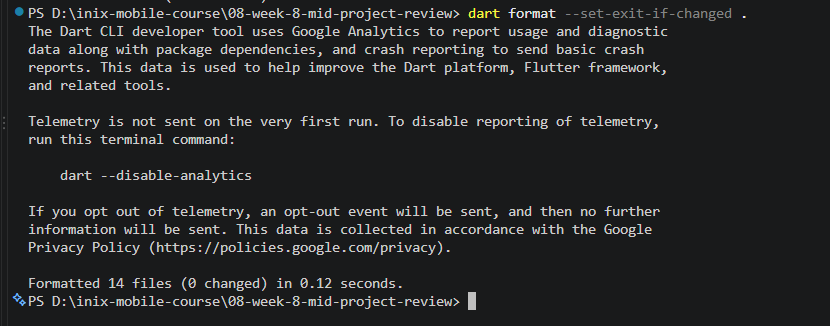
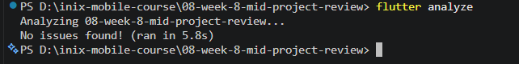
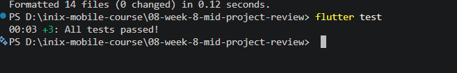
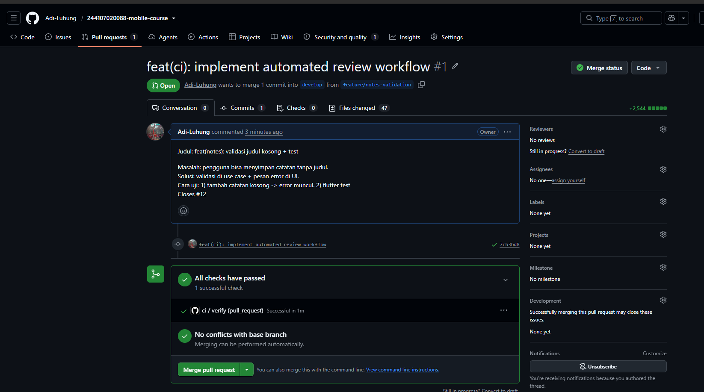

# Laporan Praktikum Pemrograman Mobile
## #08 | Kolaborasi Profesional Terstandarisasi Git Flow & Automasi CI

* **Nama Mahasiswa:** Adi Luhung
* **NIM:** 244107020088
* **Kelas:** TI-3D

---

## 1. Fitur Utama & Kesiapan Pondasi Tengah Semester
Proyek **Campus Notify** pada paruh semester ini telah mengadopsi standarisasi kerja tim profesional skala industri dengan pemenuhan kriteria kebersihan kode tingkat tinggi:
* **Mekanisme Git Flow Branching:** Isolasi pengerjaan kode terkunci rapat pada jalur aman `feature/*` dan `fix/*`, menjaga branch `develop` dan `main` steril dari kesalahan modifikasi langsung.
* **Continuous Integration Terotomatisasi:** Memanfaatkan GitHub Actions via berkas `ci.yml` untuk memicu penolakan otomatis secara mekanis jika ada kode pengajuan yang gagal melewati uji kelayakan `flutter analyze` dan `flutter test`.
* **Pondasi Arsitektur Andal:** Struktur *feature-first Clean Architecture* telah teruji bebas dari kebocoran dependensi lintas layer berdasarkan hasil audit pengujian statis gawai.

---

## 2. Dokumentasi Bukti Pengujian Mesin Hijau (Definisi Selesai)

### A. Bukti Eksekusi Kebersihan Formatter dan Linter Lokal

* **Penjelasan:** Diambil setelah menjalankan perintah `flutter analyze` dan `dart format --set-exit-if-changed .` di terminal laptop. Proyek berstatus hijau bersih tanpa ada peringatan kutipan kode maupun masalah format inden spasi kodingan.

### B. Bukti Kelulusan Unit Pengujian (Automated Testing)

* **Penjelasan:** Seluruh paket pengujian unit test independen berbasis objek simulasi palsu (*Fake Object*) berhasil lolos dengan status sempurna **All tests passed!**.

### C. Bukti Validasi Alur Kolaborasi Integrasi (GitHub Actions CI)

* **Penjelasan:** Tangkapan layar dari dashboard repositori daring yang memperlihatkan lambang centang hijau sukses dari eksekusi alur pekerjaan pipa GitHub Actions CI saat menerima pengajuan *Pull Request* baru.

---

## 3. Berkas Jawaban Refleksi Laporan Tengah Semester (Halaman 8)

* **Apa beda LGTM buta dengan approve yang bertanggung jawab? Apa risikonya bagi tim?**
  *Jawaban:* LGTM (*Looks Good To Me*) buta terjadi ketika seorang rekan tim menyetujui *Pull Request* tanpa mengunduh kode, tanpa menjalankan pengujian lokal, dan hanya membaca sekilas perubahan kode. Sebaliknya, *Approve* yang bertanggung jawab dilakukan dengan memeriksa pemenuhan kebenaran struktur arsitektur, melacak celah kebocoran memori, serta memastikan kelulusan uji otomatis. Risiko LGTM buta sangat merusak tim karena dapat meloloskan kode cacat yang memicu *bug crash* di tingkat produksi, mengotori kebersihan repositori, serta melipatgandakan hutang teknis (*technical debt*).
  
* **Kapan komentar wajib berstatus request changes, dan kapan cukup saran?**
  *Jawaban:* Komentar wajib berstatus **Request Changes** ketika ditemukan kesalahan fatal bersifat *Blocker* yang merusak jalannya fungsionalitas aplikasi, seperti kegagalan kompilasi build, pelanggaran berat aturan dependensi arsitektur (kebocoran detail layer data masuk ke domain), atau hilangnya berkas pengujian uji kelayakan untuk fitur baru. Komentar cukup berstatus **Saran (Comment/Nitpick)** jika temuan hanya berupa masalah minor kosmetik kosmetik kode, saran optimasi efisiensi fungsi kodingan yang tidak mendesak, atau perbaikan dokumentasi komentar teks yang kurang rapi.
  
* **Bagian mana dari usulan AI yang Anda tolak atau sederhanakan, dan mengapa?**
  *Jawaban:* Saya menyederhanakan saran AI mengenai pembuatan Use Case terpisah untuk fungsionalitas operasi CRUD yang bersifat satu baris tanpa manipulasi data (*passthrough*). Alasan teknisnya adalah penulisan tersebut akan memicu pemborosan jumlah berkas (*over-engineering*) pada tim skala kecil. Saya memutuskan tetap mempertahankan kontrak akses langsung via Notifier state sepanjang sterilitas arah panah dependensi layer tidak terlanggar.
